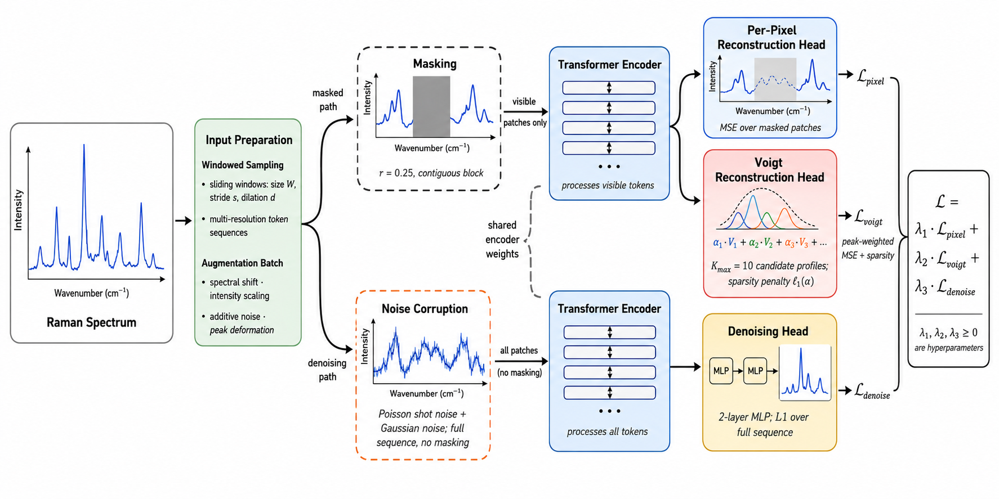

# multidomain-raman-ssl

This project learns reusable representations of Raman spectra from multiple experimental domains. It combines masked spectrum reconstruction, physics-inspired peak reconstruction, and supervised denoising in a shared transformer encoder, then evaluates the learned representations through downstream classification and mixture analysis. Experiments compare models trained from scratch with frozen-encoder probes and fine-tuned pretrained models.

<p align="center">
  
</p>

## How the project works

The implementation uses PyTorch and Lightning. Models, datasets, training settings, logging, and checkpointing are selected through YAML configuration files and the `main.py` command-line entry point.

Spectra are represented by two channels: Raman shift (wavenumber) and intensity. Dataset-specific loaders handle file formats, intensity preprocessing, shared wavenumber scaling, augmentation, and optional spectrum slicing. The encoder processes sequences of spectral observations, allowing datasets with different spectral lengths to contribute separate batches to the same training run.

The masked autoencoder (MAE) has a shared transformer encoder and separate reconstruction heads. Pretraining alternates between masking a contiguous random region, a region around the strongest peak, or the end of a spectrum. A further peak-masking task uses a parametric pseudo-Voigt decoder to reconstruct peaks. The loss selects ordinary reconstruction MSE, a combination of peak-weighted and ordinary pseudo-Voigt reconstruction error with an amplitude penalty, or denoising L1 loss according to the task. The `wv_in_loss` setting controls whether reconstruction losses include the wavenumber channel.

`MultiTaskDataModule` interleaves batches from the configured datasets and cycles shorter loaders to match the longest loader. The supplied pretraining configurations mix full and sliced spectra from several domains with paired noisy/clean spectra for denoising.

Downstream evaluation includes:

- **Training from scratch:** a randomly initialized spectral encoder with a linear or MLP classification head, plus separate Conv1D baseline configurations.
- **Linear probing:** a frozen pretrained encoder with a trainable linear prediction head.
- **Fine-tuning:** joint training of the pretrained encoder and a linear or MLP prediction head.
- **Attention probing:** a trainable query and cross-attention prediction head over a frozen pretrained encoder.
- **Siamese and SSP models:** paired-spectrum methods for reference/mixture comparisons, including R6G, sugars, Deep Raman, and additional SSP dataset configurations.
- **Denoising:** a dedicated spectral denoiser that can also initialize its encoder from an MAE checkpoint.

Classification modules report metrics such as accuracy, F1, AUROC, and average precision. Reconstruction modules report metrics such as MSE, MAE, and R²; denoising also includes PSNR, one-dimensional SSIM, and cosine similarity. The exact metrics depend on the selected module and task.

## Repository layout

| Location | Purpose |
| --- | --- |
| `main.py` | Lightning CLI entry point for fitting, validating, testing, and prediction |
| `configs/mae/` | Small/base/large pretraining, linear probe, and attention probe configurations |
| `configs/cls/` | Spectral transformer, Conv1D, and multitask supervised configurations |
| `configs/siamese/` | Siamese, SSP, and paired-spectrum attention probe configurations |
| `configs/denoising/` | Dedicated denoising configuration |
| `raman/backbones/` | Shared spectral encoder, MAE, Conv1D, Siamese, and SSP networks |
| `raman/dataloaders/` | Dataset loaders and multitask batch interleaving |
| `raman/dataloaders/scripts/` | Augmentation, spectrum slicing, and wavenumber utilities |
| `raman/mae/`, `raman/cls/`, `raman/siamese/`, `raman/denoising/` | Lightning training and evaluation modules |
| `requirements.txt` | Python dependencies |

Run the commands below from the repository root in your activated Python environment.

## Installation

Create an isolated environment, for example with Python 3.10:

```bash
python3 -m venv .venv
source .venv/bin/activate
python -m pip install --upgrade pip
python -m pip install -r requirements.txt
python -m pip install 'jsonargparse[signatures]==4.28.0' scikit-learn
```

The dependency file pins PyTorch 2.3.0, torchvision 0.18.0, and Lightning 2.2.4, and includes NVIDIA CUDA 12 packages. The supplied GPU examples require a compatible NVIDIA GPU and driver. For CPU or other platforms, use a platform-appropriate PyTorch installation and adapt the CUDA-specific dependency entries. `scikit-learn` is additionally required by the Siamese/SSP modules; the `jsonargparse` signatures extra supports Lightning's class-based CLI configuration.

Inspect the available commands and configuration arguments with:

```bash
python main.py --help
python main.py fit --help
```

## Prepare the data

Dataset files and pretrained checkpoints are not bundled with the repository. Obtain the datasets you intend to use and update their file locations in the selected YAML configuration. Use paths appropriate to your installation; all relative paths are resolved from the working directory where you launch the command.

| Datasets | Task |
| --- | --- |
| Adenine | Classification (binary) |
| Bacteria | Classification |
| Liver cancer | Classification |
| RRUFF-Subset (Xiancheng Sang et Al.) | Classification |
| R6G | Component Identification |
| Raman sugars | Component Identification |
| Deep Raman | Component Identification / Concentration estimation |
| GBL | Concentration estimation |
| Hyperspectral | Spectral Reconstruction |
| MDA-Spectral | Spectral Denoising |

For a single downstream dataset, edit `data.init_args`, including fields such as `data_dir`, `data_file`, `spectra_csv`, or `metadata_csv`. For MAE pretraining, edit each nested datamodule under `data.init_args.datasets_config`. Remove dataset entries you do not have, including their sliced/full variants, or provide every file required by the default configuration. Review preprocessing, split ratios, augmentation, slicing, batch size, and worker count for your data.

The loaders use `raman/dataloaders/global_wavenumber_range.json` for shared wavenumber normalization. Keep the same scaling for pretraining and downstream evaluation. If adding data outside the stored range, update the statistics consistently. The regeneration utility, `raman/dataloaders/scripts/global_wavenumbers.py`, contains fixed dataset locations that must be adapted before running it.

## Model sizes

The model size presets use the following architecture settings:

| Size | `d_model` | `encoder_depth` | `mlp_dim` | `nhead` | `dim_head` |
| --- | ---: | ---: | ---: | ---: | ---: |
| small | 64 | 4 | 256 | 4 | 64 |
| base | 128 | 4 | 512 | 4 | 128 |
| large | 256 | 6 | 1024 | 4 | 256 |

All three MAE configurations specify two input channels, `decoder_depth: 2`, and `mask_ratio: 0.25`. The current MAE backbone uses Conv1D/MLP reconstruction heads; `decoder_depth` is an exposed configuration argument rather than the depth of a transformer decoder.

The downstream examples below use the **base** settings. For scratch runs with a different size, override all architecture fields in the table. When loading a pretrained checkpoint, keep downstream settings compatible with its encoder. MAE probes load the pretrained model from the checkpoint, while some paired-spectrum models also require matching explicit encoder dimensions.

## 1. Pretrain the masked autoencoder

After adapting the dataset locations, start a base MAE run:

```bash
python main.py fit \
  --config configs/mae/mae-config-base.yaml \
  --trainer.strategy auto \
  --trainer.devices 1 \
  --trainer.accelerator gpu
```

Select `mae-config-small.yaml` or `mae-config-large.yaml` for another size. The supplied MAE configurations use 50 epochs, learning rate `0.00015`, and weight decay `0.000001`.

To resume training, use an explicit checkpoint from the run you want to continue:

```bash
python main.py fit \
  --config configs/mae/mae-config-base.yaml \
  --trainer.strategy auto \
  --trainer.devices 1 \
  --trainer.accelerator gpu \
  --ckpt_path mae-logs-base/version_0/checkpoints/last.ckpt
```

Replace `version_0` with the actual run version. `--ckpt_path` restores the training state, including optimizer and epoch progress.

## 2. Train a supervised model from scratch

Train an Adenine classifier with a base encoder and linear head:

```bash
python main.py fit \
  --config configs/cls/cls-spectra-adenine-config.yaml \
  --trainer.logger.init_args.save_dir TRAIN/cls-spectra-adenine \
  --trainer.logger.init_args.name seed_17 \
  --trainer.strategy auto \
  --trainer.devices 1 \
  --trainer.accelerator gpu \
  --trainer.max_epochs 50 \
  --model.init_args.input_channels 2 \
  --model.init_args.d_model 128 \
  --model.init_args.encoder_depth 4 \
  --model.init_args.mlp_dim 512 \
  --model.init_args.nhead 4 \
  --model.init_args.dim_head 128 \
  --model.init_args.classification_head linear \
  --model.init_args.lr 0.0005 \
  --seed_everything 17
```

Use the matching `cls-spectra-<dataset>-config.yaml` for `gbl`, `adenine`, `bacteria`, `liver-cancer`, `sangxiancheng1`, `sangxiancheng2`, `sugars`, or `r6g`. For the MLP baseline, set `--model.init_args.classification_head mlp` and use a separate output location such as `TRAIN/cls-spectra-adenine-mlp`. For comparison, train linear and MLP heads for 50 epochs, and optionally an MLP head for 10 epochs using `--trainer.max_epochs 10`.

For SangXiancheng datasets, add `--model.init_args.weighted true`. For Bacteria scratch training, append the following data settings:

```bash
--data.init_args.data_file X_reference.npy \
--data.init_args.labels_file y_reference.npy \
--data.init_args.augment false \
--data.init_args.val_split 0.1
```

Append these flags to the Bacteria fit command. Conv1D baselines can be selected using the corresponding `configs/cls/cls-conv1d-<dataset>-config.yaml`; their model arguments differ from the transformer examples.

## 3. Probe or fine-tune a pretrained encoder

Set the checkpoint you produced during MAE pretraining:

```bash
PRETRAINED_CKPT=mae-logs-base/version_0/checkpoints/last.ckpt
```

The `pretrained_ckpt` model argument initializes the encoder for a new downstream experiment. It is distinct from `--ckpt_path`, which resumes or evaluates the complete experiment checkpoint.

### Linear probe

```bash
python main.py fit \
  --config configs/mae/linear-probe-adenine-config.yaml \
  --trainer.logger.init_args.save_dir TRAIN/adenine-logs-probe \
  --trainer.logger.init_args.name seed_17 \
  --trainer.strategy auto \
  --trainer.devices 1 \
  --trainer.accelerator gpu \
  --model.init_args.pretrained_ckpt "$PRETRAINED_CKPT" \
  --model.init_args.freeze_enc true \
  --model.init_args.classification_head linear \
  --model.init_args.lr 0.0001 \
  --seed_everything 17
```

### Fine-tuning

Use the same linear-probe configuration with `--model.init_args.freeze_enc false`. Select `linear` or `mlp` for the classification head and a separate run location:

```bash
python main.py fit \
  --config configs/mae/linear-probe-adenine-config.yaml \
  --trainer.logger.init_args.save_dir TRAIN/adenine-logs-fine-mlp \
  --trainer.logger.init_args.name seed_17 \
  --trainer.strategy auto \
  --trainer.devices 1 \
  --trainer.accelerator gpu \
  --model.init_args.pretrained_ckpt "$PRETRAINED_CKPT" \
  --model.init_args.freeze_enc false \
  --model.init_args.classification_head mlp \
  --model.init_args.lr 0.0001 \
  --seed_everything 17
```

### Attention probe

```bash
python main.py fit \
  --config configs/mae/attention-probe-adenine-config.yaml \
  --trainer.logger.init_args.save_dir TRAIN/adenine-logs-probe-att \
  --trainer.logger.init_args.name seed_17 \
  --trainer.strategy auto \
  --trainer.devices 1 \
  --trainer.accelerator gpu \
  --model.init_args.pretrained_ckpt "$PRETRAINED_CKPT" \
  --model.init_args.freeze_enc true \
  --model.init_args.lr 0.0001 \
  --seed_everything 17
```

MAE linear and attention probe configurations are available for `gbl`, `adenine`, `bacteria`, `liver-cancer`, `sangxiancheng1`, `sangxiancheng2`, and `sugars`. Use their dataset-specific YAML files to retain the correct task, labels, and loader. Epoch counts come from the selected configuration unless explicitly overridden.

For SangXiancheng probes/fine-tuning, add `--model.init_args.weighted true`. For Bacteria probing and fine-tuning, switch to `X_finetune.npy` and `y_finetune.npy`, disable augmentation, set `val_split` to `0.1`, and set `--trainer.max_epochs 30`.

R6G uses `configs/siamese/siamese-r6g-config.yaml` for probing/fine-tuning and `configs/siamese/siamese-attention-probe-r6g-config.yaml` for attention probing. These modules use `freeze_encoder` instead of `freeze_enc`; the Siamese model has its own prediction head. Sugars and Deep Raman also have explicit Siamese configurations. Deep Raman does not have a matching MAE probe configuration, so select its files in `configs/siamese/` directly. Use each module's own arguments rather than forwarding MAE decoder or mask arguments to it.

## 4. Evaluate a trained checkpoint

Evaluate MAE reconstruction using the pretraining checkpoint:

```bash
python main.py test \
  --config configs/mae/mae-config-base.yaml \
  --trainer.logger.init_args.save_dir mae-test-logs \
  --trainer.strategy auto \
  --trainer.devices 1 \
  --trainer.accelerator gpu \
  --ckpt_path "$PRETRAINED_CKPT"
```

For downstream evaluation, use the saved run configuration and checkpoint together. For example:

```bash
python main.py test \
  --config TRAIN/adenine-logs-probe/seed_17/version_0/config.yaml \
  --ckpt_path TRAIN/adenine-logs-probe/seed_17/version_0/checkpoints/last.ckpt \
  --trainer.logger.init_args.save_dir TEST/adenine-logs-probe \
  --trainer.strategy auto \
  --trainer.devices 1 \
  --trainer.accelerator gpu \
  --data.init_args.augment false
```

Substitute the scratch, fine-tuning, or attention-probe run paths as appropriate. Keep the original prediction head and architecture settings. Saved downstream configurations can retain a reference to the original pretraining checkpoint, so keep that checkpoint accessible as well.

## Additional experiments

The same CLI can launch the dedicated denoiser or paired-spectrum models after their data settings are adapted:

```bash
python main.py fit --config configs/denoising/denoising-config.yaml
python main.py fit --config configs/siamese/siamese-r6g-config.yaml
python main.py fit --config configs/siamese/ssp-sugars-config.yaml
```

To initialize the denoiser from an MAE encoder, set its `pretrained_ckpt` argument, choose `freeze_encoder` according to the experiment, and match its head dimensions to the pretrained encoder. Check the chosen configuration's model class and arguments before reusing overrides from another experiment type.

## Reproducibility, hardware, and outputs

Use seeds for repeated experiments. Repeat a command with each `--seed_everything` value and a matching logger name such as `seed_x` or `seed_y`. Use a separate output location for each model size, dataset, and head/mode combination. Lightning versions runs automatically, but explicit names make comparisons easier.

The examples select one GPU. For multiple local GPUs, set `--trainer.devices 2` (or the desired count) and use `--trainer.strategy ddp`; probe/fine-tuning modules with unused parameters may require `ddp_find_unused_parameters_true`. For CPU execution, override `--trainer.accelerator cpu --trainer.devices 1 --trainer.strategy auto`. Reduce dataset-specific batch sizes and `num_workers` if necessary.

For a quick data/model integration check, append `--trainer.fast_dev_run true` to a fit command after preparing the data. This executes a short run and does not produce normal training checkpoints.

CSVLogger writes run metrics and Lightning saves the resolved configuration and checkpoints. With the output names above, a typical downstream run contains:

```text
TRAIN/adenine-logs-probe/seed_17/version_0/
├── config.yaml
├── metrics.csv
└── checkpoints/
    ├── last.ckpt
    └── <monitored-checkpoint>.ckpt
```

Use the checkpoint selected by validation loss for model selection, or `last.ckpt` to evaluate the final training state. Record the chosen checkpoint, configuration, seed, data splits, and normalization statistics when comparing results.

## License

The code is distributed under the MIT license. See [LICENSE](LICENSE), which also includes the retained third-party notices for code adapted from vit-pytorch and DeepRaman. Separate copies of their licenses are in [THIRD_PARTY_LICENSES](THIRD_PARTY_LICENSES/). Dependencies installed separately retain their own licenses. Dataset licenses and access conditions are separate from the code license.
